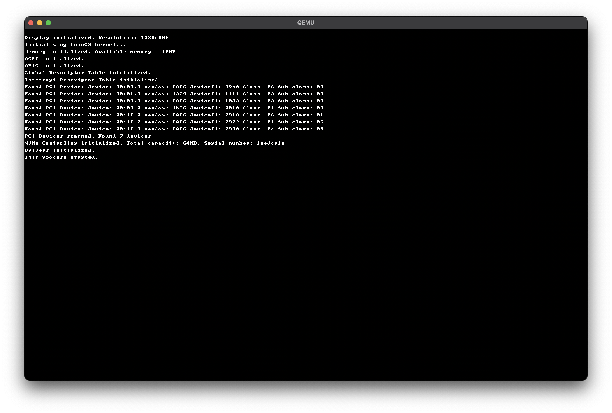

# Luix Operating System

Luix is a hobby operating system being developed in Rust. 

It is a 64-bit operating system that supports both x86-64 and AArch64 architectures, and it is heavily inspired by POSIX systems.


## Features

- 64 Bits
- amd64 and aarch64 support
- Multicore
- ACPI

## Development

Install [mise](https://mise.jdx.dev) and a host C toolchain. Install QEMU to boot
LuixOS or run guest tests.

- On macOS, install Xcode Command Line Tools, then run `brew install qemu`.
- On Debian or Ubuntu, run `sudo apt install build-essential qemu-system-x86 ca-certificates`.

Use mise from the repository root.

```sh
mise install
mise run doctor    # Check installed tools
mise run build     # Build the kernel and init
mise run test:all  # Run host and guest tests
mise run run       # Boot LuixOS in QEMU
```

The first boot or guest test run downloads the required boot files. Use
`mise run setup` to download them in advance.

| Other task | Description |
| --- | --- |
| `check` | Type-check the kernel, userland, and host tools |
| `image` | Create `target/images/luix-os.img` |
| `image:test` | Create `target/images/luix-os-test.img` |
| `run:bios` | Boot in legacy BIOS mode (currently stops during ACPI initialization) |
| `debug` | Boot with UEFI and wait for GDB on `localhost:1234` |
| `test` | Run host tests |
| `test:build` | Build the guest test kernel |
| `test:qemu` | Build the test image and run guest tests in QEMU |
| `fmt`, `fmt:check` | Format, or check formatting |
| `lint` | Run Clippy and ShellCheck |
| `ci` | Check formatting, lint, and run all tests |
| `clean` | Remove build output and disk images |

Kernel tests marked `#[test]` run on the host and in QEMU. Tests marked
`#[test(target = "qemu")]` run only in QEMU.

## Roadmap

### Bootloader
- [x] Bootloader(powered by Limine)

### Kernel
- [x] Graphic text mode
- [x] Interrupt Descriptor Table
- [x] Basic interrupt handling
- [x] Advanced Configuration and Power Interface(ACPI)
    - [x] Root System Description Table(RSDT)
    - [x] System Description Table(SDT)
    - [x] Multiple APIC Description Table(Madt)
- [ ] Advanced Programmable Interrupt Controller(APIC)
    - [x] Local APIC(Single Processor)
    - [ ] Local APIC(Multiple Processors)
    - [x] IO APIC
- [x] Interrupt handling with stack information
- [ ] Memory management
  - [x] Linked List Allocator
  - [ ] Paging
    - [x] Address Translation
    - [x] Page mapping
    - [x] Page unmapping
    - [ ] Address space switching
  - [x] Physical Memory Manager
    - [x] Memory Allocation
    - [x] Memory Deallocation
  - [x] Virtual Memory Manager
- [ ] Drivers
  - [x] Keyboard
  - [x] Timer
  - [x] PCI
  - [x] Storage
    - [x] NVMe 
- [x] Global Descriptor Table
- [ ] System Calls
- [ ] Task Scheduler
- [ ] File System
  - [x] FAT32 Read Support
  - [ ] Ext2
  - [ ] VFS
    - [x] Read-only VFS for the boot filesystem
- [ ] Process Management
  - [x] Process Creation
  - [ ] Process Termination
  - [ ] Process Scheduling
- [ ] User Mode
- [ ] Syscalls
  - [x] Spawn
- [ ] Multicore
    - [ ] Booting on multiple cores
    - [ ] Inter-Processor Interrupts(IPI)

### User land
- [ ] Init process
  - [ ] Mount root filesystem
  - [ ] Start shell
- [ ] Shell

## Screenshots


